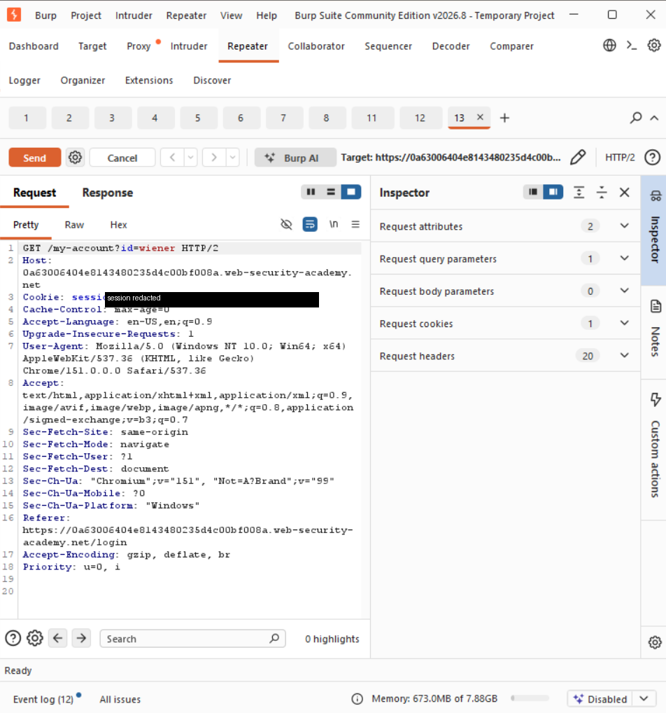
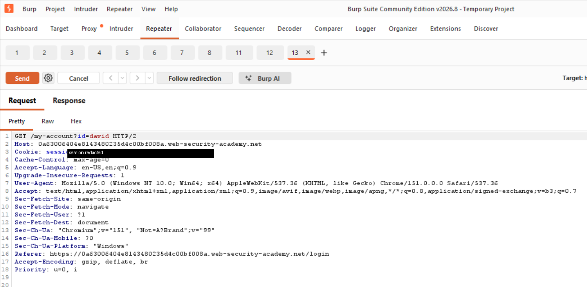
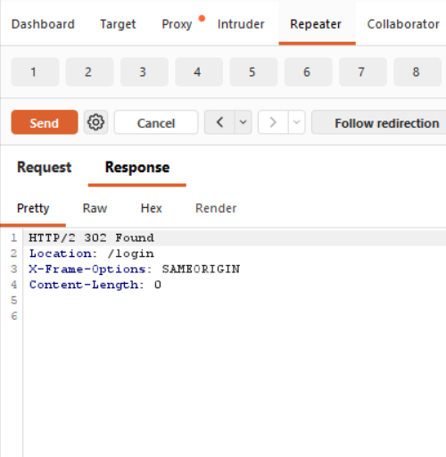

# Day 02 — Modifying HTTP Requests

> **Learning journal — tool fundamentals.** This is a study note on learning Burp Suite, not
> a vulnerability finding. Vulnerability write-ups use the finding-centric format under
> [`labs/`](../../labs/).

**Source:** Official PortSwigger Burp Suite getting-started documentation, practised against a
PortSwigger Web Security Academy lab instance.

---

## Objective

Confirm in practice that a request can be altered after it leaves the browser, and observe how
the server's response changes when it receives input the browser never sent. This continues the
same request captured in the [intercepting note](intercepting-http-traffic.md).

## What I practised

- Sending a captured request to **Repeater**
- Changing a single parameter value and resending
- Comparing the response with the original

## Original request

The `GET /my-account?id=wiener` request sent to Repeater, unchanged. In the
[intercepting note](intercepting-http-traffic.md) this request returned `HTTP/2 200 OK` with my
own account page.

*(The lab session cookie value is masked.)*

## Modification

I changed the `id` query parameter from `wiener` to `david` and resent the request. Nothing
else was altered.

## Result

The server responded differently. Instead of a `200` with an account page, the modified request
returned `HTTP/2 302 Found` with `Location: /login` — a redirect rather than another user's
account data.

So the same endpoint returned `200` for `id=wiener` (my own account) and `302 → /login` for
`id=david`. Changing one parameter changed the server's behaviour — and here the application
redirected rather than returning the other account, which is the response of an app that is
checking access. How an application *should* and *should not* handle that parameter is exactly
what the access-control labs under [`labs/`](../../labs/) examine.

## What I took from it

The browser applies constraints — field lengths, input types, dropdown options, disabled
controls, client-side validation. None of those constraints exist once the request is in
transit. The server receives a sequence of bytes and cannot tell whether they came from the
interface it served or from a proxy.

So:

- **Client-side validation is a usability feature, not a security control.** It helps
  legitimate users and stops nothing else.
- **Every parameter is input the server must validate independently**, including values the
  interface never allowed the user to change.
- **A single changed parameter can change the server's behaviour** — which is the mechanism
  behind the access-control and injection labs under [`labs/`](../../labs/).

Coming from development, this is the point that reframes things: validation I would write in an
Angular form is not a barrier to anything. It has to be duplicated and enforced server-side,
because the server-side check is the only one that exists as far as an attacker is concerned.

## Ethical scope

This exercise was performed against an authorised PortSwigger Web Security Academy lab
instance, using my own browser routed through Burp. It was limited to resending my own request
with one parameter changed, to learn how Repeater works. The lab session cookie is masked in
the request screenshots. No security testing was performed against any system I do not own or
have authorisation to test.
