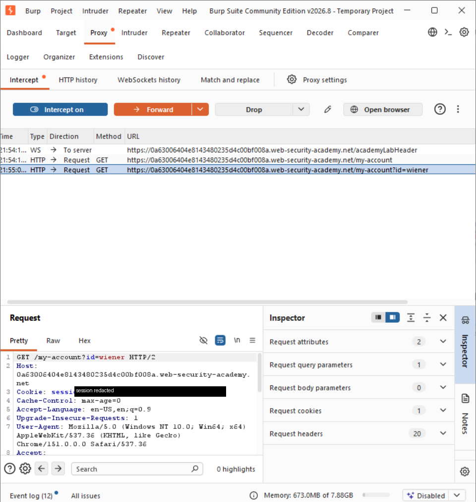
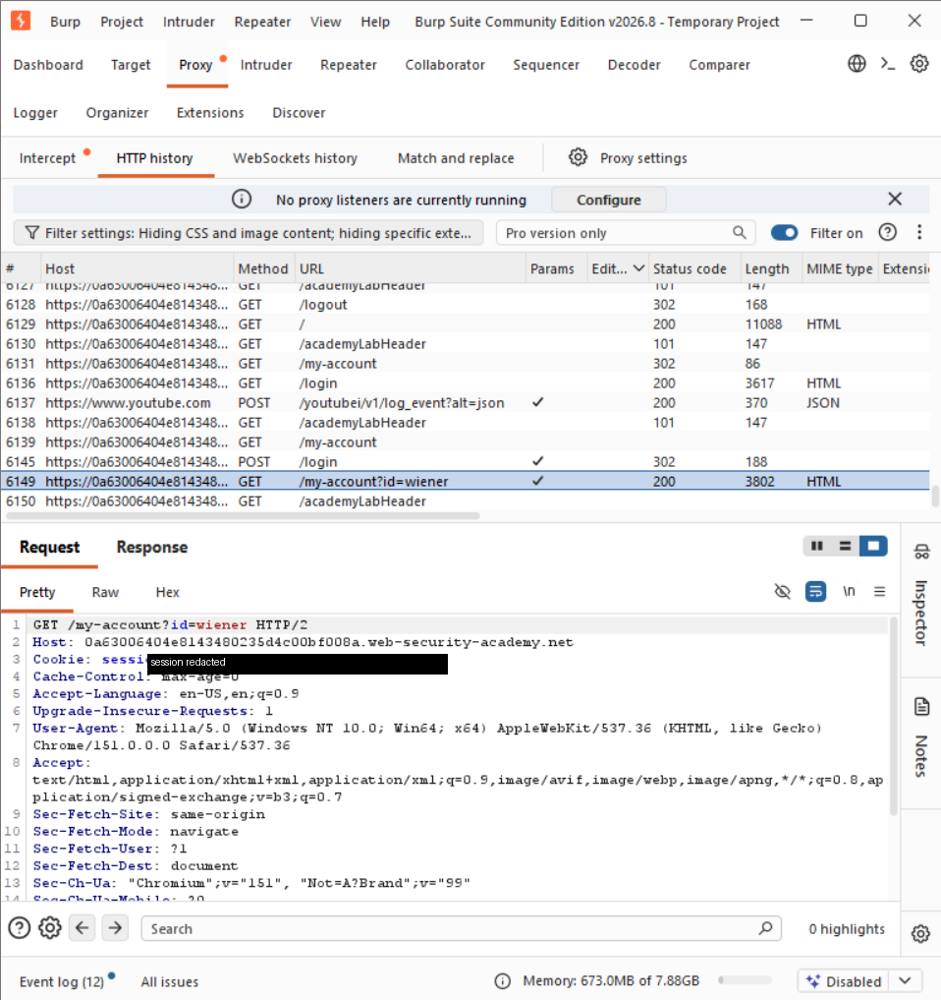
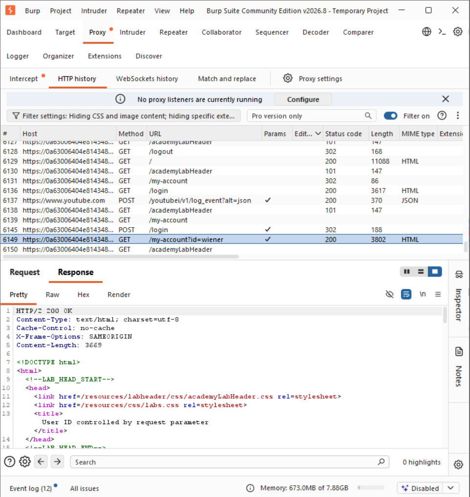

# Intercepting HTTP Traffic with Burp Suite

> **Study note — tool fundamentals.** This is a note on learning Burp Suite, not
> a vulnerability finding. Vulnerability write-ups use the finding-centric format under
> [`labs/`](../../labs/).

**Source:** Official PortSwigger Burp Suite getting-started documentation, practised against a
PortSwigger Web Security Academy lab instance.

---

## Objective

Move from reading about HTTP requests to observing them directly — following one request from
the moment it is intercepted, through its full headers, to the server's response.

## Tool

**Burp Suite Community Edition.** Burp operates as an intercepting proxy: it sits between the
browser and the server. The browser is configured to send its traffic through Burp, Burp
forwards it on, and the response returns along the same path. Because Burp holds each request
mid-path, an authorised tester can inspect, pause, modify, or reissue it before it continues.

For HTTPS, this requires Burp's CA certificate to be trusted by the browser. Without it, the
browser correctly rejects Burp's connection, because Burp is acting as a deliberate
man-in-the-middle. Installing the certificate is an explicit decision to trust that
interception, on my own machine, for my own traffic.

## Intercepting HTTP traffic

With interception enabled, a request is held in the Proxy > Intercept tab rather than being
sent straight on. Here a `GET /my-account?id=wiener` request is paused mid-flight, and can be
forwarded, dropped, or edited before it continues. The request line, the `Host`, the session
cookie and the standard browser headers are all visible in the request panel.

The `id=wiener` query parameter is worth noting: it is client-controlled, which is the kind of
parameter that turns out to matter in the access-control labs under [`labs/`](../../labs/).

## HTTP history

Alongside live interception, the **HTTP history** records traffic that has already passed
through the proxy, so a flow can be reviewed after the fact rather than pausing at every step.
Selecting the `GET /my-account?id=wiener` entry shows its full request.

## Inspecting the response

Switching to the **Response** tab for that entry shows what the server returned: the status
line (`HTTP/2 200 OK`), the response headers — including `X-Frame-Options: SAMEORIGIN` — and
the HTML body of the account page.

Seeing the request and its response side by side is the core loop of web testing: send
something, read exactly what comes back, and compare it against what you expected.

## What I took from it

The browser interface shows a curated version of what an application allows. The proxy shows
what is actually sent and received. A control that hides a button, disables a field, or blocks
a route in the client is absent at this layer — the request can still be read, constructed and
sent. This is the practical foundation for testing access control: a control enforced only in
the interface can be demonstrated to not exist, rather than merely asserted.

## Ethical scope

This exercise was performed against an authorised PortSwigger Web Security Academy lab
instance, using my own browser routed through Burp. The lab session cookie is masked in the
request screenshots. No security testing was performed against any system I do not own or have
authorisation to test.
