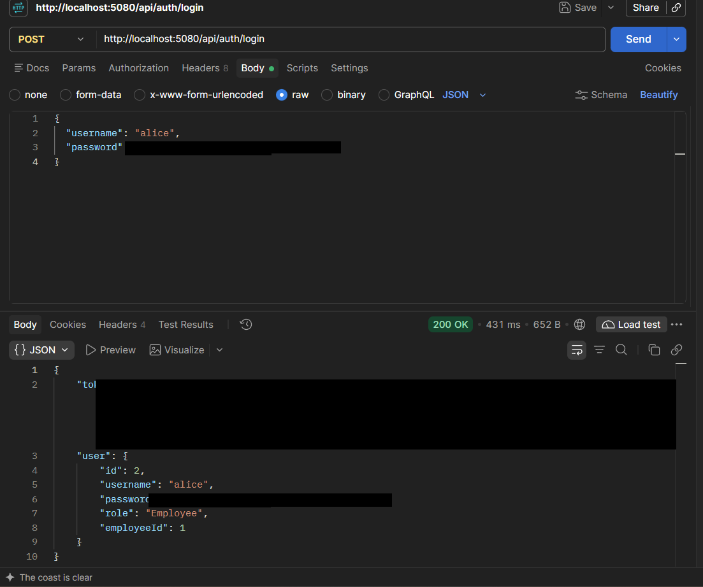
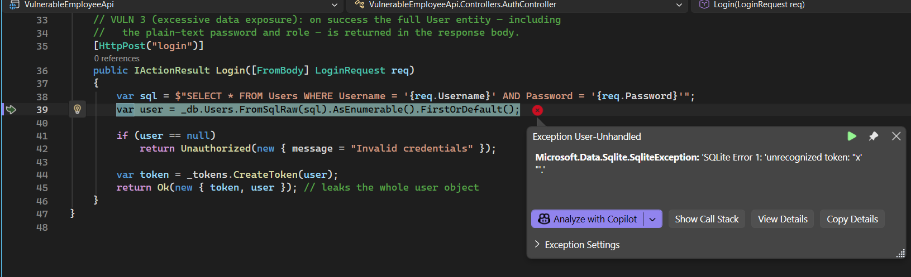
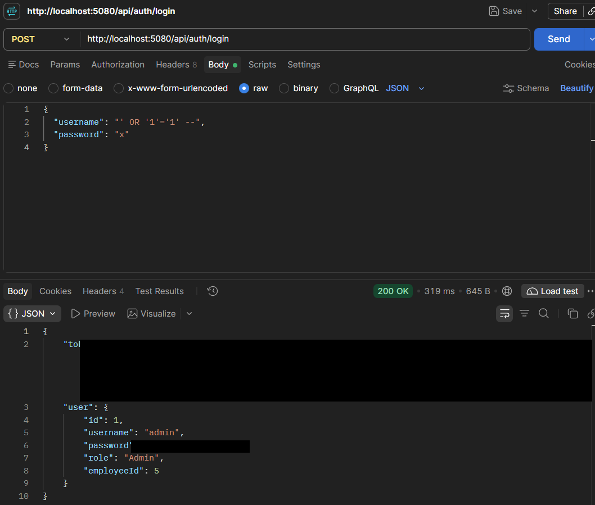

# Finding 01 — SQL Injection: Authentication Bypass

> Part of a self-built Application Security lab: a deliberately vulnerable
> .NET 8 Web API (Employee Management) that I attack, document, and fix.
> This finding covers the login endpoint.

| | |
|---|---|
| **Severity** | 🔴 Critical |
| **CVSS 3.1** | 9.8 — `AV:N/AC:L/PR:N/UI:N/S:U/C:H/I:H/A:H` |
| **Category** | OWASP Top 10 A03:2021 – Injection · CWE-89 (SQL Injection) · CWE-287 (Improper Authentication) |
| **Affected endpoint** | `POST /api/auth/login` |
| **Tools used** | Postman, Visual Studio (server-side observation) |
| **Status** | Reported — remediation below |

---

## Summary

The login endpoint builds its SQL query by pasting the submitted username and
password directly into the query text. Because the input is treated as part of
the query instead of as data, I was able to log in as the administrator without
knowing any password.

## Description

`POST /api/auth/login` takes a username and password and looks the user up in a
SQLite database. The lookup query is assembled with string interpolation, so
anything sent in the `username` or `password` field becomes part of the SQL
statement that runs on the server. This is a classic SQL injection, and here it
leads directly to an authentication bypass.

## Steps to reproduce

1. Send a normal login to confirm the baseline behaviour:
   ```json
   { "username": "alice", "password": "Password1" }
   ```
   The API returns `200 OK` with a token.

2. Probe for injection by adding a single quote to the username:
   ```json
   { "username": "alice'", "password": "x" }
   ```
   The server returns a SQLite error — `unrecognized token` — which shows the
   input is landing inside the SQL statement rather than being treated as data.

3. Exploit it with an always-true condition and a SQL comment to drop the
   password check:
   ```json
   { "username": "' OR '1'='1' --", "password": "x" }
   ```

The query the server actually runs becomes:
```sql
SELECT * FROM Users WHERE Username = '' OR '1'='1' --' AND Password = 'x'
```
`'1'='1'` is always true and `--` comments out the rest of the line, so the
query returns every row. The code takes the first one, which is the admin
account.

## Proof of concept

**Baseline — a valid login works as expected**



**Discovery — a single quote breaks the query (input reaches the SQL)**



**Exploit — logged in as admin with the password `x`**



Response to the exploit request:
```json
{
  "token": "eyJhbGciOiJIUzI1NiIsInR5cCI6IkpXVCJ9...",
  "user": {
    "id": 1,
    "username": "admin",
    "password": "Admin@123",
    "role": "Admin",
    "employeeId": 5
  }
}
```
`200 OK`, a valid JWT, and the administrator account returned — authenticated as
`admin` (role `Admin`) using the password `x`.

## Impact

- Full authentication bypass with no valid credentials.
- The attacker is placed in the administrator account, so this is complete
  account takeover.
- Once authenticated as admin, every other endpoint is reachable: reading,
  editing, and deleting all employee records.
- The same concatenation pattern exists on the employee search endpoint, so the
  injection can be extended with a `UNION` query to dump every stored
  credential.

## Severity

**Critical.** The attack is unauthenticated, takes a single request, needs no
special conditions, and results in full administrative compromise.

CVSS 3.1 base score **9.8** — `AV:N/AC:L/PR:N/UI:N/S:U/C:H/I:H/A:H`.

## Root cause

User input is concatenated into a raw SQL string and executed with `FromSqlRaw`,
so there is no separation between the query and the data:

```csharp
// Controllers/AuthController.cs
var sql = $"SELECT * FROM Users WHERE Username = '{req.Username}' AND Password = '{req.Password}'";
var user = _db.Users.FromSqlRaw(sql).AsEnumerable().FirstOrDefault();
```

A second problem makes the outcome worse: passwords are stored and compared in
clear text, so there is no hashing to get in the way once a row is returned.

## Remediation

Never build SQL by concatenating input. Look the user up with a parameterised
query so the input can only ever be data, and verify a hashed password rather
than a plain-text one:

```csharp
// Parameterised lookup — input is sent separately from the query, so a quote
// is just a quote and can never change the query's structure.
var user = _db.Users.FirstOrDefault(u => u.Username == req.Username);

if (user == null || !PasswordHasher.Verify(req.Password, user.PasswordHash))
    return Unauthorized(new { message = "Invalid credentials" });
```

Notes:
- EF Core's LINQ (`FirstOrDefault(u => u.Username == req.Username)`) parameterises
  automatically. If raw SQL is genuinely needed, use parameters —
  `FromSqlRaw("... WHERE Username = {0}", req.Username)` — never string
  interpolation.
- Store passwords as a salted hash (for example ASP.NET Core's
  `PasswordHasher<T>`), and compare with a verify function.
- Return the same generic `Invalid credentials` message whether the username or
  the password is wrong, so the endpoint doesn't reveal which usernames exist.

## Verification (retest)

After the fix, re-send the exploit request:
```json
{ "username": "' OR '1'='1' --", "password": "x" }
```
Expected result: `401 Unauthorized`. The quote is now treated as literal text
inside the username value, the lookup finds no matching user, and the bypass
fails. (Add the retest screenshot here once the fix is applied.)

## References

- OWASP — SQL Injection: https://owasp.org/www-community/attacks/SQL_Injection
- OWASP Top 10 — A03:2021 Injection: https://owasp.org/Top10/A03_2021-Injection/
- PortSwigger Web Security Academy — SQL injection: https://portswigger.net/web-security/sql-injection
- CWE-89 — SQL Injection: https://cwe.mitre.org/data/definitions/89.html
- Microsoft Learn — Raw SQL queries in EF Core (parameterisation): https://learn.microsoft.com/en-us/ef/core/querying/sql-queries
