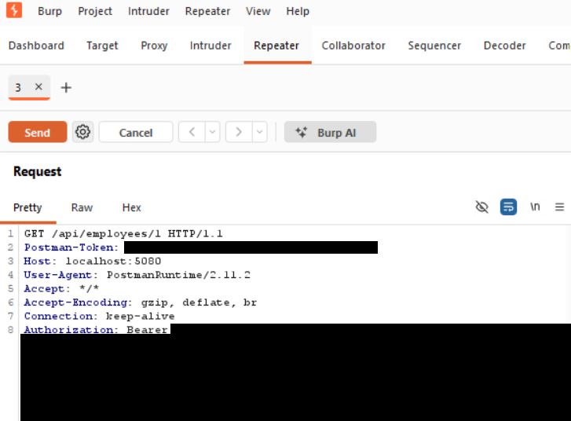

# Finding 03 — IDOR / Broken Object-Level Authorization: Read Any Employee Record

> Part of a self-built Application Security lab: a deliberately vulnerable
> .NET 8 Web API (Employee Management) that I attack, document, and fix.
> This finding covers the single-employee lookup endpoint.

| | |
|---|---|
| **Severity** | 🟡 Medium |
| **CVSS 3.1** | 6.5 — `AV:N/AC:L/PR:L/UI:N/S:U/C:H/I:N/A:N` |
| **Category** | OWASP API Security Top 10 — API1:2023 Broken Object Level Authorization (BOLA) · OWASP A01:2021 Broken Access Control · CWE-639 |
| **Affected endpoint** | `GET /api/employees/{id}` |
| **Authentication** | Any valid user token (tested as a standard Employee) |
| **Tools used** | Burp Suite (Repeater), Postman |
| **Status** | Reported — remediation below |

---

## Summary

The endpoint that returns a single employee looks the record up by the `id` in
the URL without checking whether that record belongs to the caller. Logged in as
a normal employee (`alice`, who owns employee 1), I changed the `id` to `5` and
read the Head of Engineering's confidential record — salary, National Insurance
number, and private notes — none of which I should be able to see.

## Description

`GET /api/employees/{id}` is protected with `[Authorize]`, so a caller must be
logged in. But authentication only proves *who* you are; it says nothing about
*what* you are allowed to see. The endpoint never checks that the requested `id`
belongs to the caller or that the caller is an administrator, so any
authenticated user can read any employee record simply by changing the number in
the URL. Because the ids are sequential (1, 2, 3 …), an attacker can walk the
entire table.

## Steps to reproduce

1. Log in as a standard employee (`alice` / `Password1`) and note the token.
2. Request your own record — the legitimate case:
   ```
   GET /api/employees/1
   Authorization: Bearer <alice's token>
   ```
   Returns alice's own record (`200 OK`).
3. Send that request to Burp Repeater.
4. Change the id in the path from `1` to `5` and send:
   ```
   GET /api/employees/5
   Authorization: Bearer <alice's token>
   ```
5. The API returns employee 5 — Priya Nair, Head of Engineering — a record alice
   has no relationship to.

## Proof of concept

> Sensitive values are redacted in the screenshots below as a matter of good
> practice: the bearer token (a live credential), the National Insurance number
> (a government identifier), and the salary. Enough is left visible to prove the
> cross-user access.

**Baseline — alice requests her own record (`/api/employees/1`)**



**Exploit — the same token reads employee 5's confidential record (`/api/employees/5`)**


The exploit response (`200 OK`) returns a record belonging to a different person,
including fields a normal employee should never see:
```json
{
  "id": 5,
  "fullName": "Priya Nair",
  "email": "priya@acme.test",
  "department": "Management",
  "salary": <redacted>,
  "nationalInsurance": "<redacted>",
  "performanceNotes": "Head of Engineering. Confidential comp package."
}
```

## Impact

- Any authenticated user can read every employee's record by changing the `id`.
- Exposed data includes names, salaries, **National Insurance numbers** (personal
  data under UK GDPR), and confidential performance and compensation notes — for
  the entire workforce, not just one person.
- The sequential ids make enumeration trivial: a short loop over `1..N` dumps the
  whole table.

## Severity

**Medium** by CVSS base score (6.5), because the attack requires a valid login
and is read-only. In a real engagement this would usually be escalated in
business terms: it discloses National Insurance numbers and pay for every
employee, which is a reportable personal-data exposure. Broken Object Level
Authorization is also the number-one risk in the OWASP API Security Top 10, so
it carries weight beyond the raw score.

CVSS 3.1 base score **6.5** — `AV:N/AC:L/PR:L/UI:N/S:U/C:H/I:N/A:N`.

## Root cause

The lookup trusts the `id` from the URL and performs no ownership or role check:

```csharp
// Controllers/EmployeesController.cs
[HttpGet("{id}")]
public IActionResult GetById(int id)
{
    var employee = _db.Employees.Find(id);   // no check that this record is the caller's
    if (employee == null) return NotFound();
    return Ok(employee);
}
```

The class-level `[Authorize]` enforces authentication only. There is no
object-level authorization.

## Remediation

Enforce an ownership (or admin) check before returning the record. The caller's
own employee id is already in the JWT as the `employeeId` claim:

```csharp
using System.Security.Claims;

[HttpGet("{id}")]
public IActionResult GetById(int id)
{
    var isAdmin = User.IsInRole("Admin");
    var callerEmployeeId = int.TryParse(User.FindFirstValue("employeeId"), out var e) ? e : -1;

    // A normal user may only read their own record.
    if (!isAdmin && id != callerEmployeeId)
        return Forbid();                    // 403 — authenticated but not authorised

    var employee = _db.Employees.Find(id);
    if (employee == null) return NotFound();

    return Ok(employee.ToDto());            // DTO omits salary/NI for non-admins
}
```

Defence in depth:
- Apply the same ownership/role check on every endpoint that takes an `id`
  (`PUT`, `DELETE` — see the broken-authorization finding).
- Use non-sequential identifiers (GUIDs) so records can't be enumerated by
  guessing.
- Return a DTO that exposes only the fields the caller is entitled to, so even an
  authorised read doesn't leak more than necessary.

## Verification (retest)

After the fix, repeat the attack as alice:
```
GET /api/employees/5   → 403 Forbidden   (not her record)
GET /api/employees/1   → 200 OK          (her own record still works)
```
(Add the retest screenshot here once the fix is applied.)

## References

- OWASP API Security Top 10 (2023) — API1 Broken Object Level Authorization: https://owasp.org/API-Security/editions/2023/en/0xa1-broken-object-level-authorization/
- OWASP Top 10 — A01:2021 Broken Access Control: https://owasp.org/Top10/A01_2021-Broken_Access_Control/
- PortSwigger Web Security Academy — IDOR: https://portswigger.net/web-security/access-control/idor
- CWE-639 — Authorization Bypass Through User-Controlled Key: https://cwe.mitre.org/data/definitions/639.html
