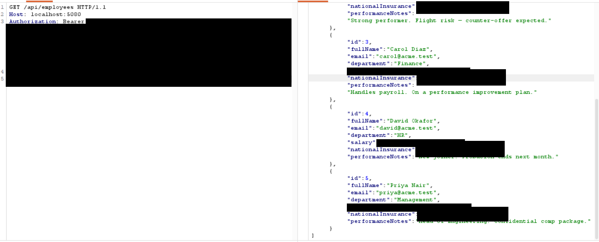
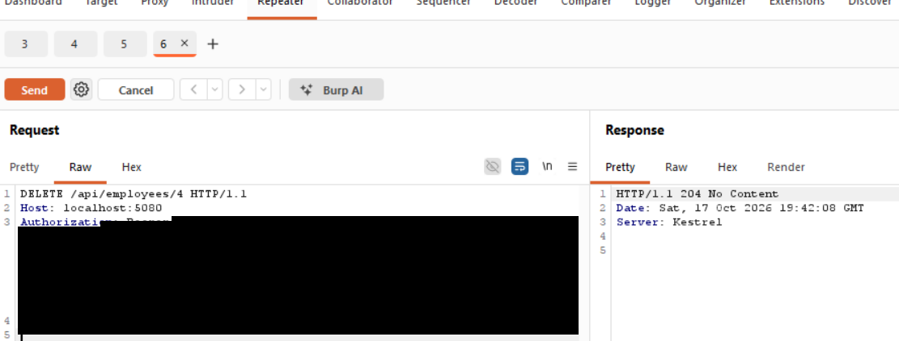
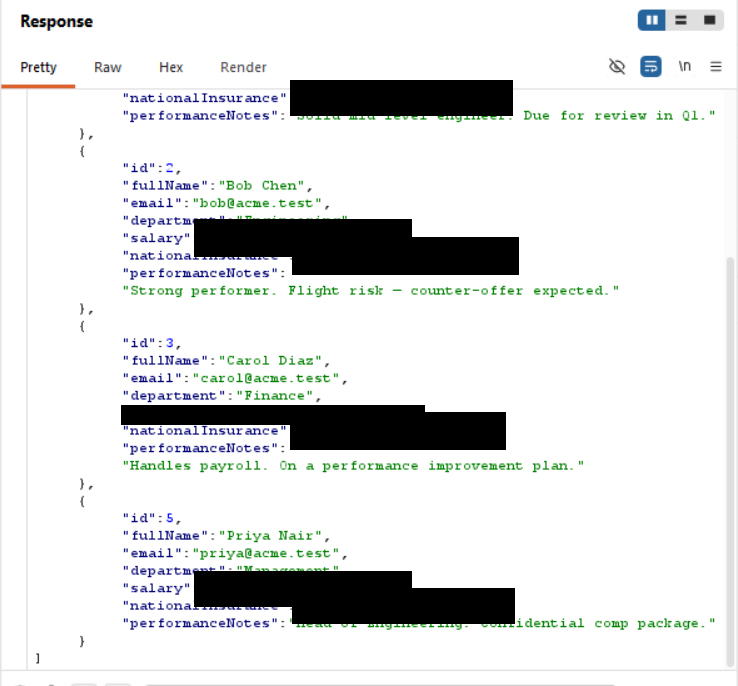
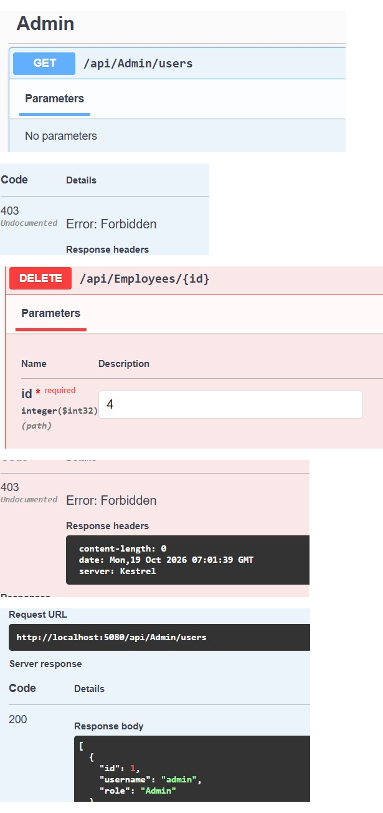

# Finding 04 — Broken Function-Level Authorization: Admin Actions by a Normal User

> Part of a self-built Application Security lab: a deliberately vulnerable
> .NET 8 Web API (Employee Management) that I attack, document, and fix.
> This finding covers the admin endpoint and the state-changing employee endpoints.

| | |
|---|---|
| **Severity** | 🟠 High |
| **CVSS 3.1** | 8.8 — `AV:N/AC:L/PR:L/UI:N/S:U/C:H/I:H/A:H` |
| **Category** | OWASP API Security Top 10 — API5:2023 Broken Function Level Authorization · OWASP A01:2021 Broken Access Control · CWE-862 (Missing Authorization) |
| **Affected endpoints** | `GET /api/admin/users`, `DELETE /api/employees/{id}` (also `PUT`) |
| **Authentication** | Any valid user token (tested as a standard Employee) |
| **Tools used** | Burp Suite (Repeater) |
| **Status** | Reported — remediation below |

---

## Summary

Several endpoints that should be restricted to administrators only check that
the caller is *logged in*, not that the caller is an *admin*. Logged in as a
standard employee (`alice`), I read the admin-only user list (every account and
password) and deleted another employee's record — both actions a normal user
should never be able to perform.

## Description

Authentication answers "who are you"; authorization answers "are you allowed to
do this". These endpoints enforce the first and skip the second. The admin user
report and the employee `DELETE` (and `PUT`) are guarded only by `[Authorize]`,
so any authenticated user — regardless of role — can call them.

Two concrete abuses:
1. **Reading admin-only data** — `GET /api/admin/users` returns the full account
   list, including passwords, to a normal employee.
2. **Performing a destructive admin action** — `DELETE /api/employees/{id}` lets
   a normal employee permanently delete any record.

## Steps to reproduce

Log in as a standard employee (`alice` / `Password1`) and use that token.

**A — reach an admin-only endpoint**
```
GET /api/admin/users
Authorization: Bearer <alice's token>
```
Returns `200 OK` with every user account (and password). This endpoint should be
admin-only.

**B — perform an admin-only destructive action**
```
GET    /api/employees          → note 5 employees (id 4 present)
DELETE /api/employees/4        → 204 No Content
GET    /api/employees          → 4 employees (id 4 gone)
```

## Proof of concept

> Sensitive values are redacted in the screenshots: the bearer token, the
> plain-text passwords, and the salary / National Insurance fields. Usernames,
> roles, ids, and names are left visible to prove the access.

**A — a standard employee reads the admin-only user list**


**B1 — before: the employee list contains id 4 (David Okafor)**



**B2 — a standard employee deletes employee 4**



**B3 — after: id 4 is gone from the list**



## Impact

- Any authenticated user can read the entire account list, including credentials
  (confidentiality).
- Any authenticated user can modify or permanently delete any employee record
  (integrity and availability) — the delete is irreversible.
- Combined with the login SQL injection (Finding 01), an unauthenticated attacker
  can obtain a token and then perform these admin actions.

## Severity

**High.** The attack requires only a standard login, takes a single request per
action, and allows both disclosure of all credentials and destructive changes to
data. Broken Function Level Authorization is a top-tier risk in the OWASP API
Security Top 10.

CVSS 3.1 base score **8.8** — `AV:N/AC:L/PR:L/UI:N/S:U/C:H/I:H/A:H`.

## Root cause

The endpoints enforce authentication but not role/function-level authorization:

```csharp
// Controllers/AdminController.cs — admin report guarded only by [Authorize]
[HttpGet("users")]
[Authorize]                                   // any logged-in user passes
public IActionResult GetAllUsers() => Ok(_db.Users.ToList());

// Controllers/EmployeesController.cs — class has [Authorize]; no role check here
[HttpDelete("{id}")]
public IActionResult Delete(int id) { /* deletes any record */ }
```

There is no `Roles`/policy requirement, so the role carried in the JWT is never
checked for these privileged operations.

## Remediation

Require the admin role on every privileged endpoint:

```csharp
// Admin-only report
[HttpGet("users")]
[Authorize(Roles = "Admin")]
public IActionResult GetAllUsers() =>
    Ok(_db.Users.Select(u => u.ToDto()));     // DTO, so no passwords are returned

// Admin-only destructive actions
[HttpDelete("{id}")]
[Authorize(Roles = "Admin")]
public IActionResult Delete(int id) { ... }

[HttpPut("{id}")]
[Authorize(Roles = "Admin")]                  // or an ownership check for self-service edits
public IActionResult Update(int id, UpdateEmployeeRequest req) { ... }
```

Defence in depth:
- Default to deny: decide the required role/policy for every endpoint rather than
  leaving it at "any authenticated user".
- Prefer policy-based authorization for anything more complex than a role check.
- Never return passwords — store salted hashes and project to a DTO.

## Verification (retest)

After the fix, repeat as alice:
```
GET    /api/admin/users   → 403 Forbidden
DELETE /api/employees/4   → 403 Forbidden
```
Both succeed only with an Admin token. 

**Confirmed — retest passed, the attack is now blocked:**



## References

- OWASP API Security Top 10 (2023) — API5 Broken Function Level Authorization: https://owasp.org/API-Security/editions/2023/en/0xa5-broken-function-level-authorization/
- OWASP Top 10 — A01:2021 Broken Access Control: https://owasp.org/Top10/A01_2021-Broken_Access_Control/
- PortSwigger Web Security Academy — Access control vulnerabilities: https://portswigger.net/web-security/access-control
- CWE-862 — Missing Authorization: https://cwe.mitre.org/data/definitions/862.html
