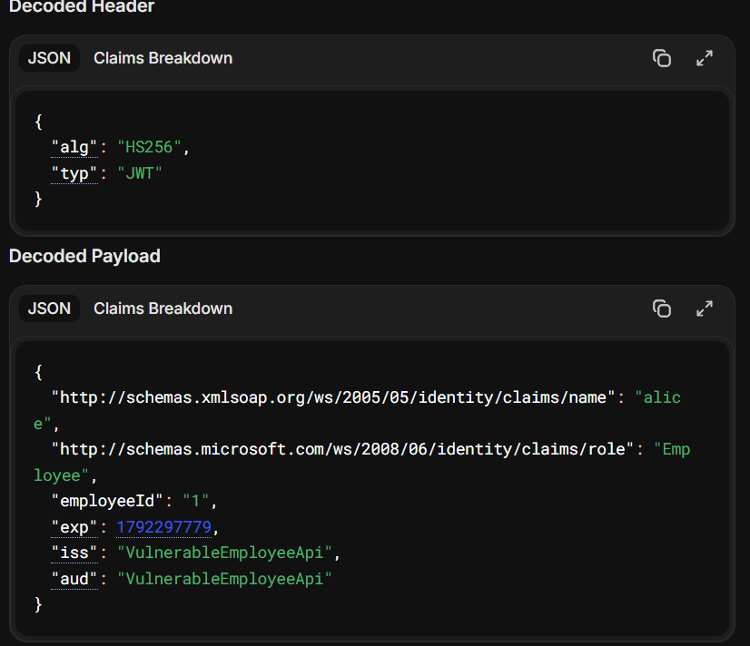
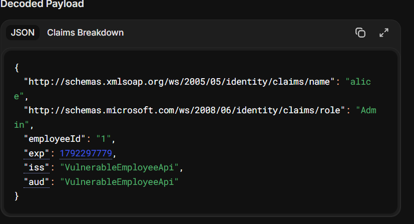
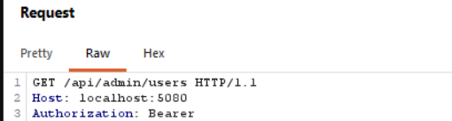
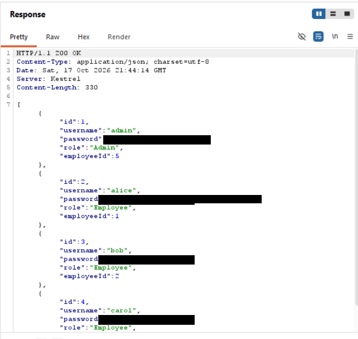
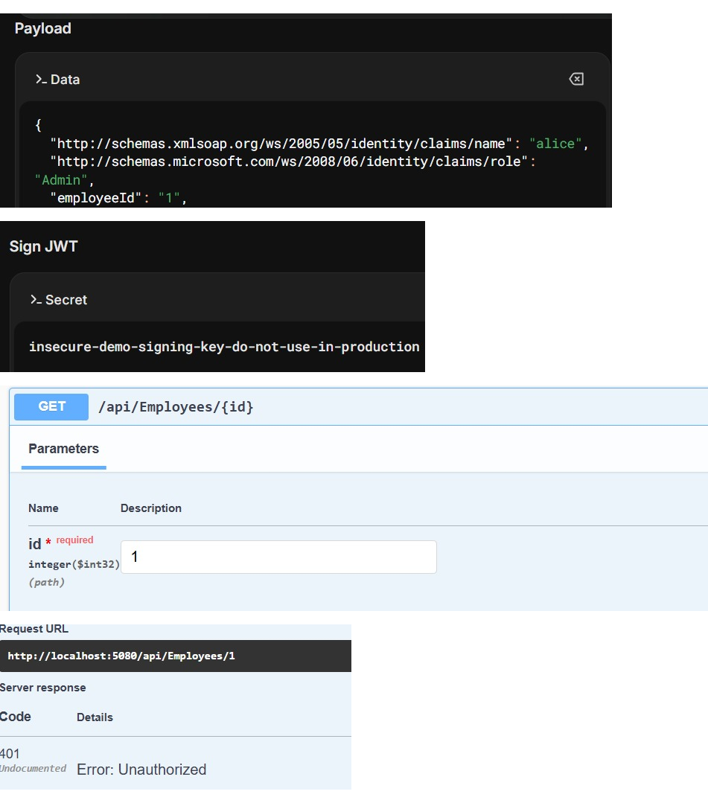

# Finding 05 — Weak JWT: Forgeable Tokens via a Hard-coded, Low-Entropy Signing Key

> Part of a self-built Application Security lab: a deliberately vulnerable
> .NET 8 Web API (Employee Management) that I attack, document, and fix.
> This finding covers the JWT authentication layer.

| | |
|---|---|
| **Severity** | 🔴 Critical |
| **CVSS 3.1** | 9.8 — `AV:N/AC:L/PR:N/UI:N/S:U/C:H/I:H/A:H` |
| **Category** | OWASP API Security Top 10 — API2:2023 Broken Authentication · OWASP A02:2021 Cryptographic Failures / A07:2021 Identification and Authentication Failures · CWE-321 (Use of Hard-coded Cryptographic Key) |
| **Affected** | Every JWT-protected endpoint (demonstrated on `GET /api/admin/users`) |
| **Tools used** | jwt.io, Burp Suite |
| **Status** | Reported — remediation below |

---

## Summary

The API signs its JWTs with HS256 using a short, human-readable key that is
committed in `appsettings.json`. Because the same secret both signs and verifies
tokens, anyone who can read the repository (or guess/crack the key) can forge a
valid token with any identity and role. I took a standard employee's token,
changed the role claim to `Admin`, re-signed it with the committed key, and the
API accepted it.

## Description

HS256 is symmetric: one shared secret signs tokens and verifies them. If that
secret is not actually secret, the whole authentication scheme collapses — an
attacker can mint tokens the server will trust. Here the secret is
`insecure-demo-signing-key-do-not-use-in-production`, sitting in source control
in `appsettings.json`. That is enough to forge tokens for any user and any role,
with no valid login required.

## Steps to reproduce

1. Obtain the signing key — it is committed in `appsettings.json`:
   `insecure-demo-signing-key-do-not-use-in-production`.
2. Log in as a standard employee (`alice`) and copy the token.
3. On [jwt.io](https://jwt.io), paste the token. The payload shows the role claim
   `http://schemas.microsoft.com/ws/2008/06/identity/claims/role` = `Employee`.
4. Change that claim's value to `Admin`.
5. Paste the committed key into the **Verify Signature** box so jwt.io re-signs
   the token. Copy the new, validly-signed token.
6. Send the forged token to a protected endpoint:
   ```
   GET /api/admin/users
   Authorization: Bearer <forged Admin token>
   ```
   The API returns `200 OK` — it accepted a token I signed myself.

## Proof of concept

**Original token — a standard employee (role `Employee`)**



**Forged token — role changed to `Admin`, re-signed with the committed key**



**The forged token is used against a protected endpoint…**



**…and is accepted (`200 OK`)**



> Passwords are redacted in the response screenshot.

## Impact

- **Full authentication and authorization bypass.** Because the signing key is in
  the repository, an attacker needs no valid credentials at all — they can craft a
  token from scratch with `role = Admin`, any `employeeId`, and valid
  `iss`/`aud`/`exp`, sign it with the key, and the API trusts it.
- **It defeats the fixes for the other findings.** The IDOR fix (Finding 03)
  relies on the `employeeId` claim and the broken-authorization fix (Finding 04)
  relies on the `role` claim. Both are worthless if an attacker can forge those
  claims, which this flaw allows.
- A secondary weakness compounds it: issuer and audience validation are disabled
  (`ValidateIssuer = false`, `ValidateAudience = false`), so tokens are accepted
  even if they were minted for a different service.

## Severity

**Critical.** No credentials are required (the key is public in the repo), the
attack is a single forged request, and it grants complete control by letting the
attacker impersonate any user or role.

CVSS 3.1 base score **9.8** — `AV:N/AC:L/PR:N/UI:N/S:U/C:H/I:H/A:H`.

> Note for the retest: the endpoint used here (`/api/admin/users`) is also missing
> a role check (Finding 04), so a normal token would reach it too. The forgery is
> still proven by the API accepting a token I re-signed myself. To isolate the
> privilege escalation cleanly, re-test against a role-enforcing endpoint after
> Finding 04 is fixed, and capture the contrast: a tampered token that is **not**
> re-signed returns `401`, while the re-signed one is accepted.

## Root cause

```jsonc
// appsettings.json — secret committed in source control, low entropy
"Jwt": { "Key": "insecure-demo-signing-key-do-not-use-in-production", ... }
```
```csharp
// Program.cs — issuer/audience validation turned off
options.TokenValidationParameters = new TokenValidationParameters
{
    ValidateIssuer = false,
    ValidateAudience = false,
    ValidateLifetime = true,
    ValidateIssuerSigningKey = true,
    IssuerSigningKey = new SymmetricSecurityKey(Encoding.UTF8.GetBytes(_config["Jwt:Key"]!)),
};
```

The secret is hard-coded and shared, and two of the validation checks are
disabled.

## Remediation

- **Keep the signing key out of source control.** Load it from an environment
  variable or a secret manager (dotnet user-secrets in dev, Azure Key Vault / AWS
  Secrets Manager in production). Rotate the leaked key immediately — anything
  signed with it must stop being trusted.
- **Use a long, random key** (≥ 256-bit random, not a passphrase).
- **Prefer asymmetric signing (RS256/ES256).** The auth server holds the private
  key; the API only holds the public key, so a repo leak can't be used to forge
  tokens.
- **Enable issuer and audience validation** and keep lifetimes short.

```csharp
var key = builder.Configuration["Jwt:Key"]
          ?? throw new InvalidOperationException("JWT signing key is not configured");

options.TokenValidationParameters = new TokenValidationParameters
{
    ValidateIssuer = true,
    ValidIssuer = builder.Configuration["Jwt:Issuer"],
    ValidateAudience = true,
    ValidAudience = builder.Configuration["Jwt:Audience"],
    ValidateLifetime = true,
    ValidateIssuerSigningKey = true,
    IssuerSigningKey = new SymmetricSecurityKey(Encoding.UTF8.GetBytes(key)),
    ClockSkew = TimeSpan.FromMinutes(1)
};
```

## Verification (retest)

After moving to a strong secret loaded from the environment (and ideally RS256):
- A token re-signed with the old committed key → `401 Unauthorized`.
- A token tampered without a valid signature → `401 Unauthorized`.
- Only tokens issued by the server with the real key are accepted.


**Confirmed — retest passed, the attack is now blocked:**



## References

- OWASP API Security Top 10 (2023) — API2 Broken Authentication: https://owasp.org/API-Security/editions/2023/en/0xa2-broken-authentication/
- OWASP Top 10 — A02:2021 Cryptographic Failures: https://owasp.org/Top10/A02_2021-Cryptographic_Failures/
- PortSwigger Web Security Academy — JWT attacks: https://portswigger.net/web-security/jwt
- CWE-321 — Use of Hard-coded Cryptographic Key: https://cwe.mitre.org/data/definitions/321.html
