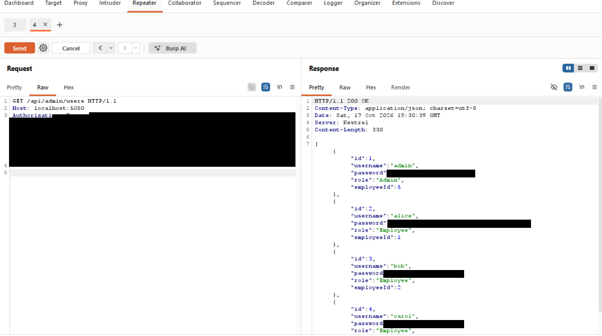
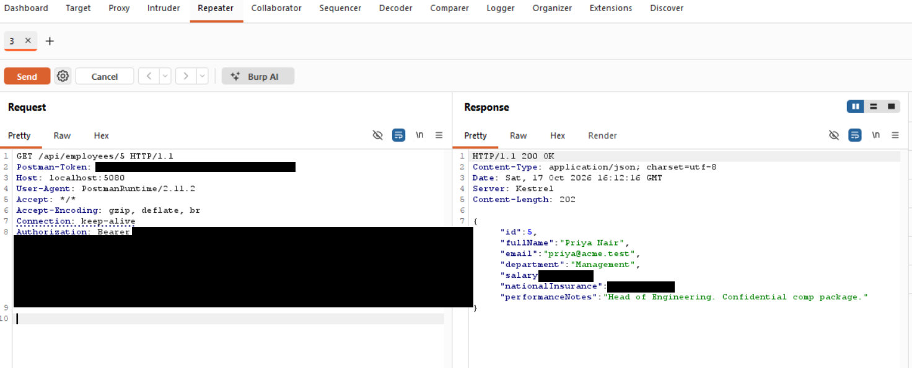

# Finding 06 — Excessive Data Exposure: Sensitive Fields Returned in API Responses

> Part of a self-built Application Security lab: a deliberately vulnerable
> .NET 8 Web API (Employee Management) that I attack, document, and fix.
> This finding covers the shape of the API's responses across several endpoints.

| | |
|---|---|
| **Severity** | 🟡 Medium |
| **CVSS 3.1** | 6.5 — `AV:N/AC:L/PR:L/UI:N/S:U/C:H/I:N/A:N` |
| **Category** | OWASP API Security Top 10 — API3:2023 Broken Object Property Level Authorization (Excessive Data Exposure) · CWE-213 / CWE-200 |
| **Affected endpoints** | `POST /api/auth/login`, `GET /api/employees`, `GET /api/employees/{id}`, `GET /api/admin/users` |
| **Tools used** | Postman, Burp Suite |
| **Status** | Reported — remediation below |

---

## Summary

The API serializes full database entities straight to JSON instead of returning
purpose-built response models. As a result, every response carries fields the
client should never receive — most seriously, user passwords in clear text, and
employees' salaries, National Insurance numbers, and private performance notes.

## Description

Each controller returns the raw Entity Framework entity (`Ok(user)`,
`Ok(_db.Employees.ToList())`, `Ok(_db.Users.ToList())`). Whatever columns exist on
the entity are sent to the caller, with no filtering for sensitivity or for the
caller's role. The data is over-shared by default; the client simply ignores the
extra fields, but an attacker reads them.

This is a distinct issue from the access-control findings: even where a caller is
*allowed* to reach an endpoint, the response still exposes far more than it
should. It was observed repeatedly while testing the other findings:

1. **Login response** (`POST /api/auth/login`) returns the full `User` object,
   including the plain-text `password` — see Finding 01.
2. **Employee endpoints** (`GET /api/employees`, `GET /api/employees/{id}`) return
   `salary`, `nationalInsurance`, and `performanceNotes` to any authenticated
   user — see Findings 02 and 03.
3. **Admin user list** (`GET /api/admin/users`) returns every user's plain-text
   `password` — see Finding 04.

## Proof of concept

> Values are redacted in the screenshots. Note that the **field names**
> (`password`, `salary`, `nationalInsurance`) are still visible — that is the
> point: these fields should never be in the response at all.

**Credentials exposed — `GET /api/admin/users` returns a `password` field per user**



**PII exposed — an employee record returns salary, NI number, and private notes**



A trimmed view of the kind of object returned (sensitive values marked):
```json
// GET /api/employees/{id}
{
  "id": 5,
  "fullName": "Priya Nair",
  "email": "priya@acme.test",
  "department": "Management",
  "salary": "<sensitive>",
  "nationalInsurance": "<sensitive PII>",
  "performanceNotes": "<confidential>"
}

// POST /api/auth/login  and  GET /api/admin/users
{ "id": 1, "username": "admin", "password": "<plain-text password>", "role": "Admin", "employeeId": 5 }
```

## Impact

- Passwords are disclosed in clear text wherever a user object is returned,
  including the login response and the admin user list.
- Employees' salaries, National Insurance numbers (personal data under UK GDPR),
  and private performance notes are returned to any authenticated caller.
- Returning more than the client needs widens the blast radius of every other
  flaw — the SQL injection and IDOR findings are far more damaging because the
  underlying objects carry this sensitive data in the first place.

## Severity

**Medium.** The exposure is serious (credentials and PII), but reaching the most
sensitive responses requires a valid login. The core problem is response shaping,
not a single catastrophic request.

CVSS 3.1 base score **6.5** — `AV:N/AC:L/PR:L/UI:N/S:U/C:H/I:N/A:N`.

## Root cause

Controllers return entities directly, with no response model and no field
filtering:

```csharp
// AuthController.cs
return Ok(new { token, user });            // whole User, incl. plain-text password

// EmployeesController.cs
return Ok(_db.Employees.ToList());         // salary, NI, performance notes for everyone
return Ok(employee);

// AdminController.cs
return Ok(_db.Users.ToList());             // every password in clear text
```

Passwords are also stored in plain text, so there is nothing safe to return even
if the field were included by mistake.

## Remediation

Return DTOs that contain only the fields a caller needs, and never include
secrets:

```csharp
public record EmployeeDto(int Id, string FullName, string Email, string Department);

var result = _db.Employees
    .Select(e => new EmployeeDto(e.Id, e.FullName, e.Email, e.Department))
    .ToList();
return Ok(result);
```

- **Never return passwords.** Store a salted hash; expose no password field at all.
- **Login** should return just the token (and, if needed, a minimal profile DTO) —
  not the user entity.
- **Make sensitive fields role-aware.** Salary and National Insurance should be
  returned only to callers entitled to them (for example an admin/HR DTO variant),
  not to every employee.
- As a safety net, mark sensitive properties with `[JsonIgnore]` so they can't be
  serialized by accident — but DTOs, not attributes, should be the primary control.

## Verification (retest)

After switching to DTOs, confirm the responses no longer contain the sensitive
fields:
- `POST /api/auth/login` → response contains a token, no `password`.
- `GET /api/employees` / `{id}` → no `salary`, `nationalInsurance`, or
  `performanceNotes` for a standard user.
- `GET /api/admin/users` → no `password` field.

(Add the retest screenshots here once the fix is applied.)

## References

- OWASP API Security Top 10 (2023) — API3 Broken Object Property Level Authorization: https://owasp.org/API-Security/editions/2023/en/0xa3-broken-object-property-level-authorization/
- PortSwigger Web Security Academy — Information disclosure: https://portswigger.net/web-security/information-disclosure
- CWE-213 — Exposure of Sensitive Information Due to Incompatible Policies: https://cwe.mitre.org/data/definitions/213.html
- CWE-200 — Exposure of Sensitive Information to an Unauthorized Actor: https://cwe.mitre.org/data/definitions/200.html
