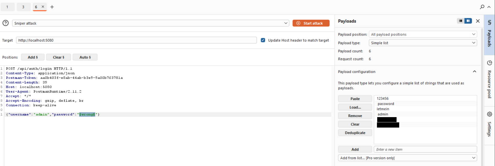
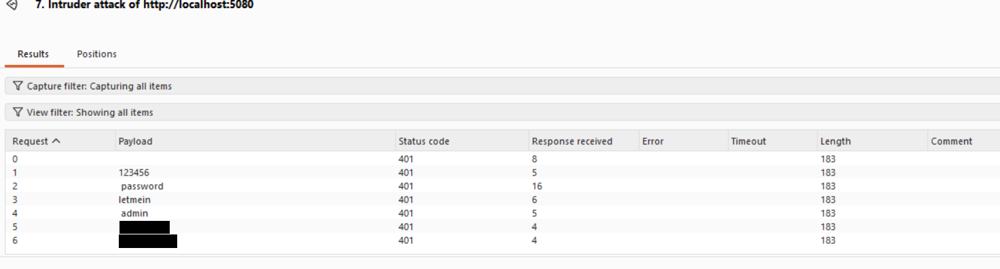

# Finding 07 — Missing Rate Limiting on Authentication

> Part of a self-built Application Security lab: a deliberately vulnerable
> .NET 8 Web API (Employee Management) that I attack, document, and fix.
> This finding covers the login endpoint's lack of request throttling.

| | |
|---|---|
| **Severity** | 🟡 Medium |
| **CVSS 3.1** | 5.3 — `AV:N/AC:L/PR:N/UI:N/S:U/C:L/I:N/A:N` |
| **Category** | OWASP API Security Top 10 — API4:2023 Unrestricted Resource Consumption (and API2:2023 Broken Authentication) · CWE-307 (Improper Restriction of Excessive Authentication Attempts) |
| **Affected endpoint** | `POST /api/auth/login` |
| **Tools used** | Burp Suite (Intruder) |
| **Status** | Reported — remediation below |

---

## Summary

The login endpoint applies no rate limiting, throttling, or account lockout. An
attacker can send unlimited password guesses as fast as the server can answer,
which makes online brute-force and credential-stuffing attacks practical.

## Description

There is nothing between an attacker and the password check: every request to
`POST /api/auth/login` is processed and answered immediately, no matter how many
have already been sent from the same source or against the same account. There is
no `429 Too Many Requests`, no temporary lockout, and no added delay after
repeated failures. Combined with the weak, human-chosen passwords in this app,
that makes guessing a valid credential a matter of time.

## Steps to reproduce

1. In Burp, send a login request to **Intruder**:
   ```
   POST /api/auth/login
   { "username": "admin", "password": "wrong" }
   ```
2. Mark the password value as the payload position (Sniper attack).
3. Load a short list of candidate passwords.
4. Start the attack and watch the results.

## Proof of concept

**Intruder configured against the login endpoint**



**Every attempt is processed — all `401`, in single-digit milliseconds, with no `429` and no lockout**



Every request in the run returned a normal `401` and was answered in a few
milliseconds. At no point did the server return `429 Too Many Requests`, lock the
account, or slow down — so the number of guesses an attacker can make is
effectively unlimited.

> The two real seed passwords used as test guesses are masked in the screenshots.
> No guess in this short list was correct; the point of the finding is the
> *absence of throttling*, not a successful login.

## Impact

- **Online brute force and credential stuffing become practical.** With no limit,
  an attacker can run large wordlists against the login endpoint until a password
  is found — especially effective here because the stored passwords are weak.
- **Resource abuse / denial of service.** The endpoint will process an unbounded
  volume of requests, which can be used to exhaust server resources.
- It compounds the other authentication weaknesses: once a password is guessed,
  the SQL injection and weak-JWT findings are no longer even needed.

## Severity

**Medium.** On its own, missing rate limiting does not disclose data or grant
access — but it is a force-multiplier that turns weak passwords into account
takeover and enables resource-exhaustion abuse.

CVSS 3.1 base score **5.3** — `AV:N/AC:L/PR:N/UI:N/S:U/C:L/I:N/A:N`.

## Root cause

No rate-limiting middleware is registered, and there is no account-lockout logic.
.NET has built-in rate limiting (`AddRateLimiter`), but it is never configured:

```csharp
// Program.cs — no rate limiter is registered, and app.UseRateLimiter() is absent
builder.Services.AddControllers();
// ...
app.UseAuthentication();
app.UseAuthorization();
```

## Remediation

Add request rate limiting to the login endpoint, plus per-account lockout:

```csharp
using System.Threading.RateLimiting;

builder.Services.AddRateLimiter(options =>
{
    options.AddFixedWindowLimiter("login", o =>
    {
        o.PermitLimit = 5;                       // 5 attempts
        o.Window = TimeSpan.FromMinutes(1);      // per minute
        o.QueueLimit = 0;
    });
    options.RejectionStatusCode = StatusCodes.Status429TooManyRequests;
});

var app = builder.Build();
app.UseRateLimiter();
```

```csharp
// AuthController.cs
[EnableRateLimiting("login")]
[HttpPost("login")]
public IActionResult Login([FromBody] LoginRequest req) { ... }
```

Defence in depth:
- **Account lockout / backoff** after a number of failed attempts for a given
  username, independent of IP.
- **Monitor and alert** on bursts of failed logins.
- Consider a CAPTCHA or step-up challenge after repeated failures.
- Combine with strong password storage (hashing) and a password policy so that
  even many guesses are unlikely to succeed.

## Verification (retest)

After the fix, repeat the Intruder run: the first few attempts return `401`, and
subsequent attempts within the window return **`429 Too Many Requests`** (or the
account is locked). (Add the retest screenshot here once the fix is applied.)

## References

- OWASP API Security Top 10 (2023) — API4 Unrestricted Resource Consumption: https://owasp.org/API-Security/editions/2023/en/0xa4-unrestricted-resource-consumption/
- OWASP — Blocking Brute Force Attacks: https://owasp.org/www-community/controls/Blocking_Brute_Force_Attacks
- Microsoft Learn — Rate limiting middleware in ASP.NET Core: https://learn.microsoft.com/en-us/aspnet/core/performance/rate-limit
- CWE-307 — Improper Restriction of Excessive Authentication Attempts: https://cwe.mitre.org/data/definitions/307.html
