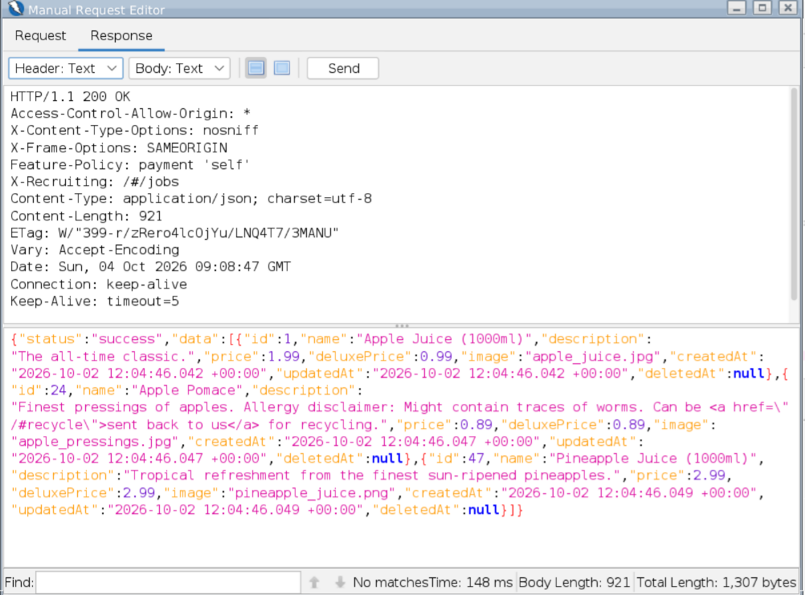
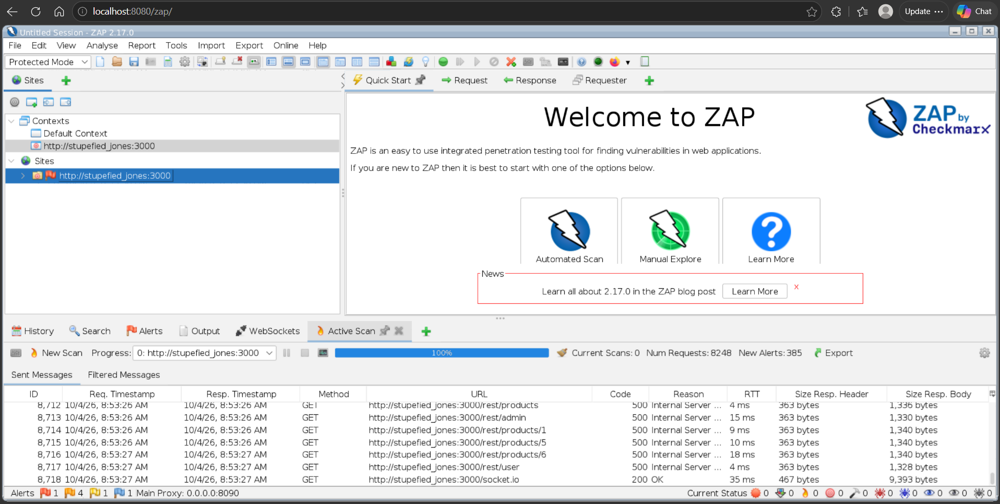
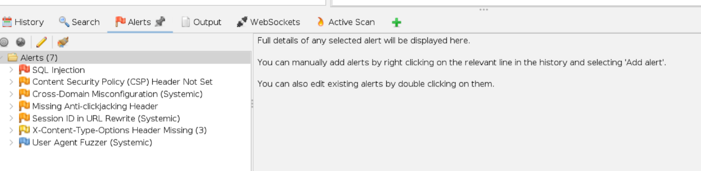
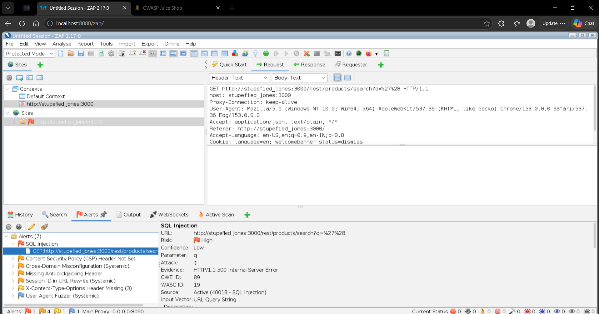
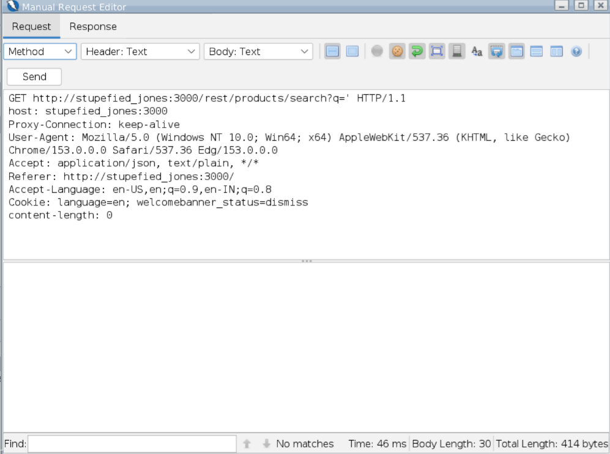
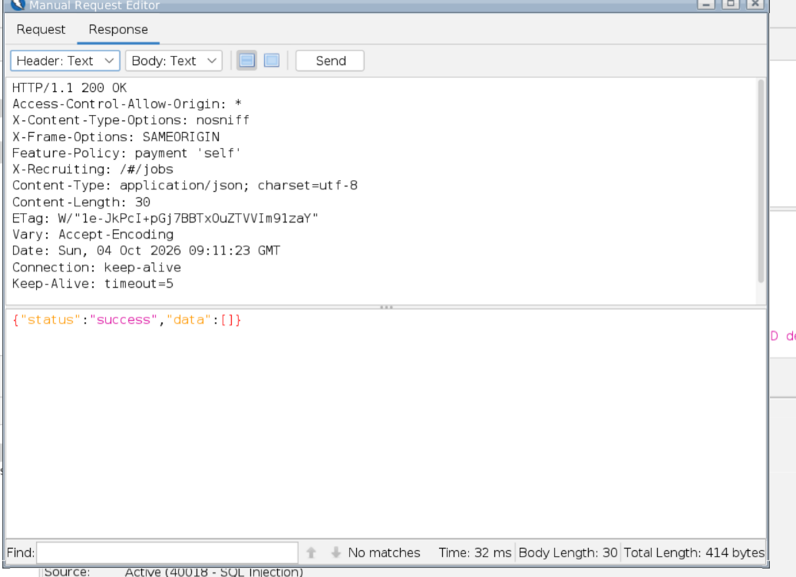
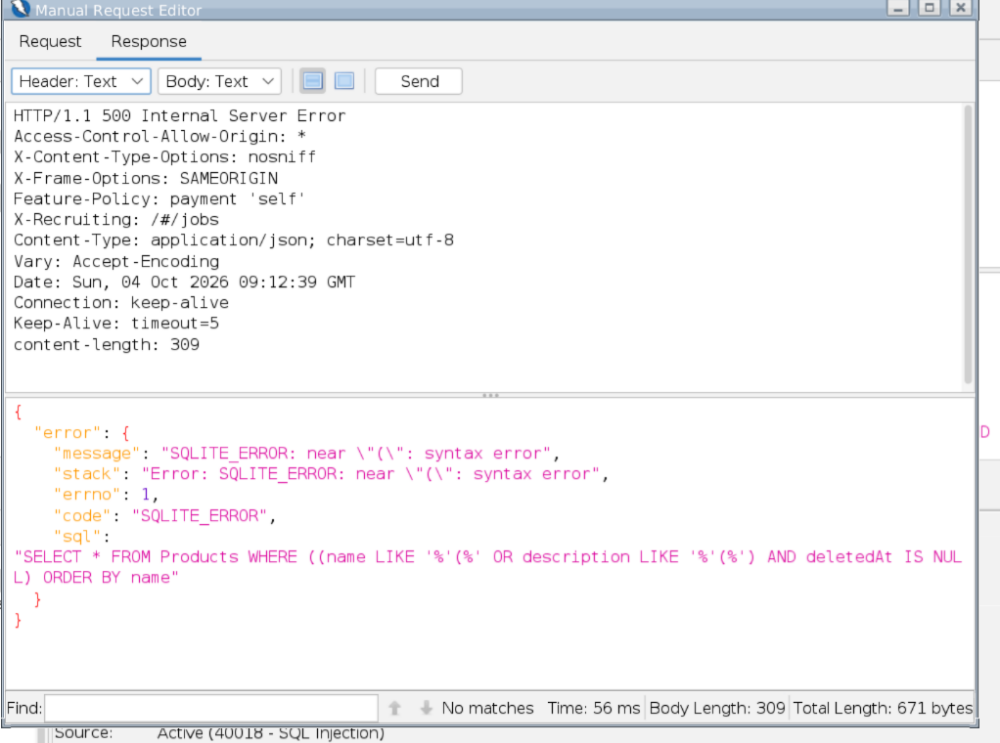

# Vulnerability Assessment — SQL Injection (Product Search Endpoint)

**Assessment tool:** OWASP ZAP 2.17.0  
**Target:** OWASP Juice Shop — local, self-hosted lab (`http://stupefied_jones:3000`)  
**Assessment type:** Active vulnerability scan + manual validation  
**Status:** Manually validated — Open

| Field | Detail |
|---|---|
| Finding | SQL Injection |
| ZAP Alert ID | 40018 |
| CWE | CWE-89 — Improper Neutralization of Special Elements used in an SQL Command |
| WASC | WASC-19 — SQL Injection |
| ZAP risk | High |
| Initial ZAP confidence | Low |
| Manual validation | Reproduced |
| Affected endpoint | `/rest/products/search` |
| Affected parameter | `q` |
| Input vector | URL query string |
| Database | SQLite |

---

## 1. Executive summary

OWASP ZAP identified a potential SQL Injection vulnerability in the product-search
functionality of OWASP Juice Shop, at `GET /rest/products/search`, through the `q` parameter.

During automated active scanning, ZAP sent a request containing SQL-special characters and the
application responded with `HTTP 500 Internal Server Error`. I then manually reproduced the
finding: the same class of payload returned a database-specific SQLite error **and** exposed the
SQL query the application was executing. This confirms user-controlled input is reaching the SQL
query layer, and that detailed database errors are disclosed to the client.

ZAP initially rated this High risk with **Low confidence** — automated alerts need
verification before they are treated as confirmed, which is exactly what the manual step below
provides.

---

## 2. Affected endpoint

```
http://stupefied_jones:3000/rest/products/search?q=<search term>
```

Normal functionality (`q=apple`) searches product names and descriptions and returns product
data:



---

## 3. Automated detection (ZAP Active Scan)

The active scan ran to completion (8,248 requests). Many crafted requests to the REST API
returned `500 Internal Server Error`, which is the signal ZAP follows up on.



The scan produced an alert set that now includes **SQL Injection** alongside the
configuration findings:



The SQL Injection alert details the request ZAP generated:

```
GET /rest/products/search?q=%27%28 HTTP/1.1
```

where `%27` = `'` and `%28` = `(`, i.e. the payload `'(`. ZAP reported **Risk: High,
Confidence: Low**, with evidence `HTTP/1.1 500 Internal Server Error`.



---

## 4. Manual validation

I investigated the alert in ZAP's **Manual Request Editor** rather than trusting the scanner
result on its own.

**Step 1 — a single quote (`q='`).** This did not error; it returned `200 OK` with an empty
result set, which already hints that the quote is being parsed as part of the query rather than
treated purely as data.





**Step 2 — the payload `'(`.** Resending with the same payload ZAP used produced the decisive
result: `HTTP/1.1 500 Internal Server Error`, a SQLite error, and the SQL statement itself in
the response body.



The response body contained:

```
SQLITE_ERROR: near "(": syntax error
"code": "SQLITE_ERROR"
```

and exposed the executing query:

```sql
SELECT * FROM Products
WHERE ((name LIKE '%('%' OR description LIKE '%('%)
AND deletedAt IS NULL)
ORDER BY name
```

---

## 5. Interpretation

The user-controlled `q` value is being placed into the SQL statement. The crafted input `'(`
made the resulting statement syntactically invalid, which produced the SQLite error. That is
strong evidence the input reaches the query layer without adequate protection. Separately, the
application returns detailed database errors — including the SQL text — directly to the client.

I did **not** attempt to extract, modify, or delete any data. The validation was limited to
demonstrating the syntax error and the information disclosure.

---

## 6. Impact

Where SQL Injection is exploitable, an attacker may be able to manipulate database queries
through crafted input. Depending on the query and the database account's permissions, that can
lead to:

- Unauthorised access to database information
- Modification or deletion of records
- Bypass of application-level restrictions
- Exposure of sensitive data
- Database errors and information disclosure

For this assessment, the validated evidence specifically demonstrates query manipulation
resulting in a database syntax error, plus disclosure of internal database information (the
SQLite error and the SQL statement).

---

## 7. Root cause

The product-search feature constructs or processes its SQL query using the user-controlled `q`
value without adequately protecting the query from SQL-special characters. The application
should not build SQL statements by concatenating untrusted input.

---

## 8. Remediation

1. **Parameterised queries / prepared statements** — bind `q` as data so it can never change
   the query's structure. This closes the class, not just this payload.
2. **Server-side input validation** — validate `q` against the expected search behaviour, as an
   additional layer (not the primary defence).
3. **Do not expose database errors** — return a generic error to the client and log the detail
   internally. The current response leaks the database technology and the SQL statement.
4. **Least-privilege database access** — the application's database account should hold only the
   permissions it actually needs.

---

## 9. Retest checklist

After remediation, against the local Juice Shop instance:

1. Normal product search still works.
2. Special characters no longer cause SQL errors.
3. No database-specific errors are returned.
4. The ZAP SQL Injection alert is no longer raised for `q`.
5. Responses no longer expose SQL queries or SQLite error messages.

---

## 10. Finding summary

| # | Finding | Severity | Confidence | Status |
|---|---|---|---|---|
| 1 | SQL Injection — product search `q` parameter | High | Manually validated | Open |
| 2 | Database error / SQL query information disclosure | Supporting impact | Confirmed by response | Open |

No CVSS score is assigned, as an exact CVSS vector was not derived from the captured evidence.

---

## Ethical scope

All testing was performed against a **local, self-hosted OWASP Juice Shop** instance — a
deliberately vulnerable application published for security training — running on my own machine.
Active scanning and manual validation were carried out only against that instance. No testing
was performed against any system I do not own or have authorisation to test.
