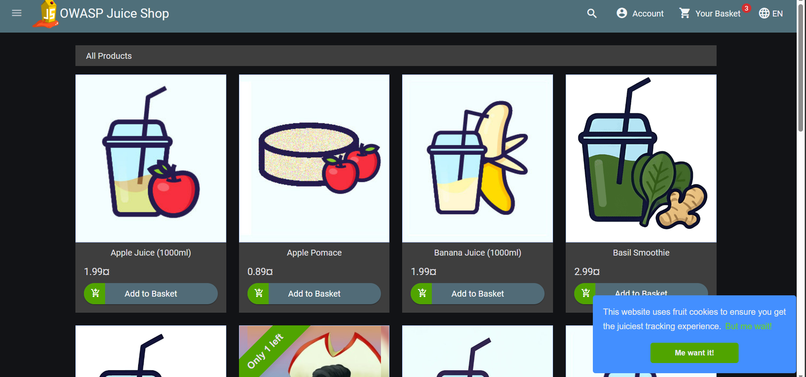
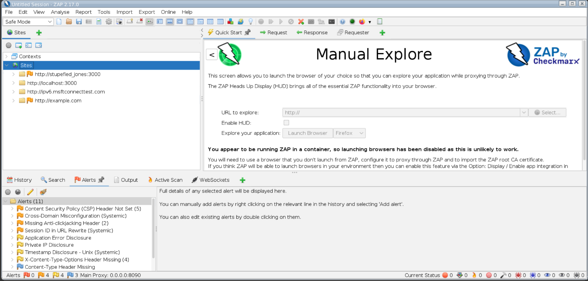
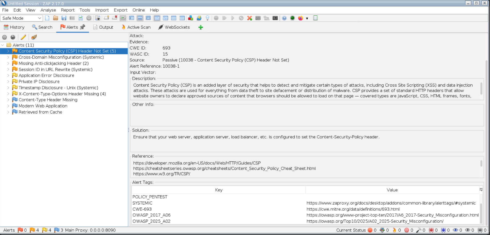
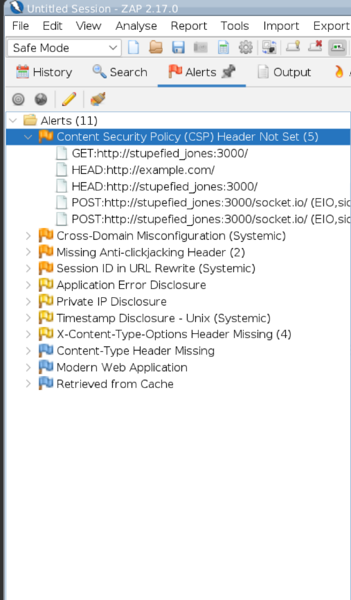
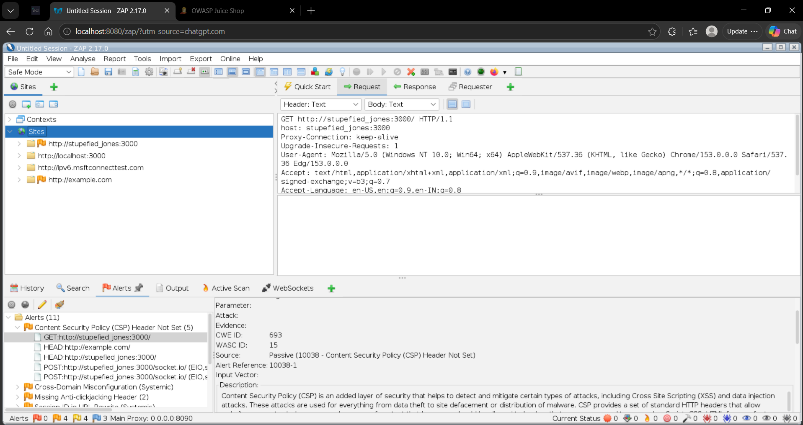
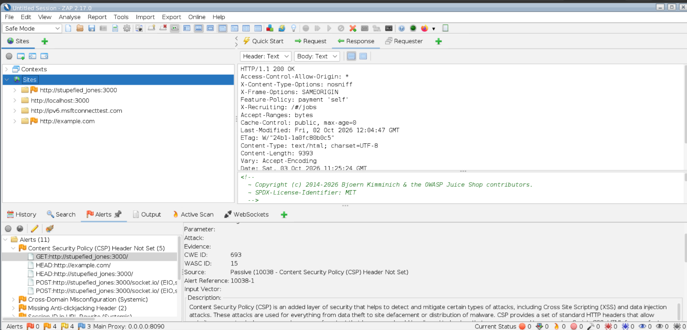

# Vulnerability Assessment — Content Security Policy (CSP) Header Not Set

**Assessment tool:** OWASP ZAP 2.17.0  
**Target:** OWASP Juice Shop — local, self-hosted lab (`http://stupefied_jones:3000`)  
**Assessment type:** Passive scan (while browsing the application)  
**Status:** Confirmed — Open

| Field | Detail |
|---|---|
| Finding | Content Security Policy (CSP) Header Not Set |
| ZAP Alert ID | 10038 |
| CWE | CWE-693 — Protection Mechanism Failure |
| WASC | WASC-15 — Application Misconfiguration |
| ZAP risk | Medium (informational-to-moderate, context dependent) |
| Source | Passive scan |
| Affected endpoint(s) | `GET /` and other responses on `http://stupefied_jones:3000` |

---

## 1. Executive summary

While browsing OWASP Juice Shop with traffic proxied through OWASP ZAP, passive scanning flagged
that the application does **not** return a `Content-Security-Policy` response header. A captured
`GET /` request returned `HTTP 200 OK` with some security headers present
(`X-Content-Type-Options: nosniff`, `X-Frame-Options: SAMEORIGIN`), but **no**
`Content-Security-Policy` header.

CSP is a browser-side defence-in-depth control that restricts where scripts and other resources
may load from. Its absence does not create a vulnerability on its own, but it removes a layer
that would otherwise reduce the impact of client-side injection flaws (such as XSS) if they
exist elsewhere in the application.

---

## 2. Target application

The assessment target is a local OWASP Juice Shop instance.



---

## 3. Passive detection

Passive scanning runs automatically on traffic that passes through the proxy while browsing — no
attack traffic is sent. The scan raised a set of configuration-related alerts, including
**Content Security Policy (CSP) Header Not Set**.



The alert details show the classification and remediation guidance: `CWE-693`, `WASC-15`,
source `Passive (10038 — Content Security Policy (CSP) Header Not Set)`, mapped to OWASP
Security Misconfiguration (A06:2017 / A02:2025).



ZAP recorded multiple instances of the missing header across different responses (GET, HEAD and
POST requests to the application):



---

## 4. Evidence

The captured request:

```
GET http://stupefied_jones:3000/ HTTP/1.1
Host: stupefied_jones:3000
...
```



The corresponding response — `HTTP/1.1 200 OK` with several headers set, but **no**
`Content-Security-Policy` header among them:

```
HTTP/1.1 200 OK
Access-Control-Allow-Origin: *
X-Content-Type-Options: nosniff
X-Frame-Options: SAMEORIGIN
Feature-Policy: payment 'self'
...
(no Content-Security-Policy header present)
```



---

## 5. Impact

CSP is an added layer of browser-side security that helps mitigate client-side attacks such as
cross-site scripting and data injection by declaring which sources of script, style and other
content the browser may load. Without it:

- there is no browser-enforced allow-list for script/resource sources;
- the potential impact of any client-side injection flaw elsewhere in the application is higher
  than it would be with a restrictive policy in place.

This is a **defence-in-depth / misconfiguration** finding rather than a directly exploitable
vulnerability. Its severity depends on what other client-side issues exist in the application.

---

## 6. Root cause

The application / web server is not configured to emit a `Content-Security-Policy` response
header.

---

## 7. Remediation

1. Configure the application or web server to return an appropriate `Content-Security-Policy`
   header, based on the application's legitimate resource requirements.
2. Start from a restrictive baseline (for example `default-src 'self'`) and add only the
   sources the application genuinely needs, rather than a permissive catch-all.
3. Validate the policy in report-only mode first (`Content-Security-Policy-Report-Only`) to
   catch legitimate resources before enforcing it.
4. Treat CSP as one layer: it complements, and does not replace, output encoding and input
   handling.

**Reference:** [MDN — Content Security Policy](https://developer.mozilla.org/en-US/docs/Web/HTTP/Guides/CSP),
[OWASP CSP Cheat Sheet](https://cheatsheetseries.owasp.org/cheatsheets/Content_Security_Policy_Cheat_Sheet.html)

---

## 8. Retest checklist

After remediation, against the local Juice Shop instance:

1. Responses include a `Content-Security-Policy` header.
2. The policy is restrictive (not simply `default-src *`).
3. The application still functions — no legitimate resources are blocked.
4. The ZAP passive alert for the missing CSP header is no longer raised.

---

## Ethical scope

This passive assessment was performed against a **local, self-hosted OWASP Juice Shop** instance
— a deliberately vulnerable application published for security training — running on my own
machine, with my own browser traffic proxied through ZAP. Passive scanning sends no attack
traffic. No testing was performed against any system I do not own or have authorisation to test.
